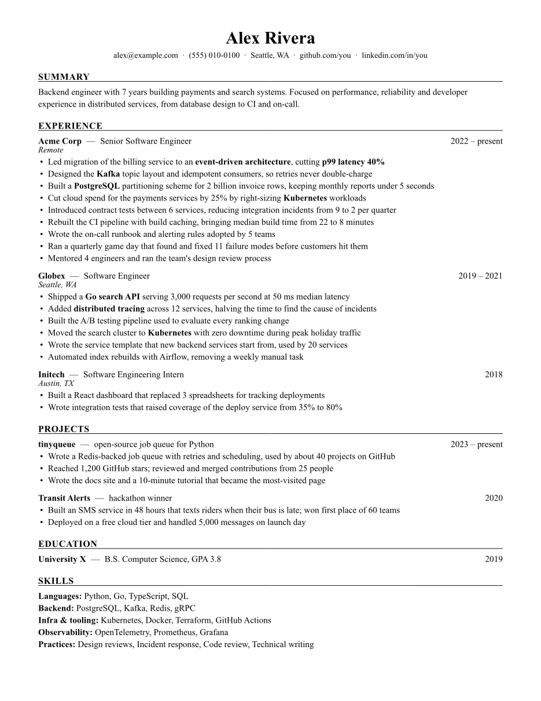
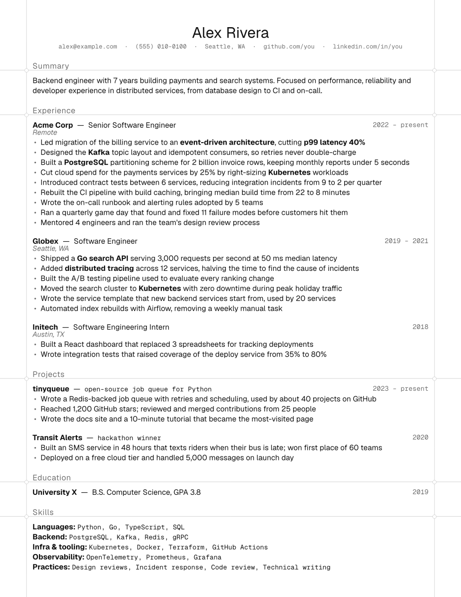
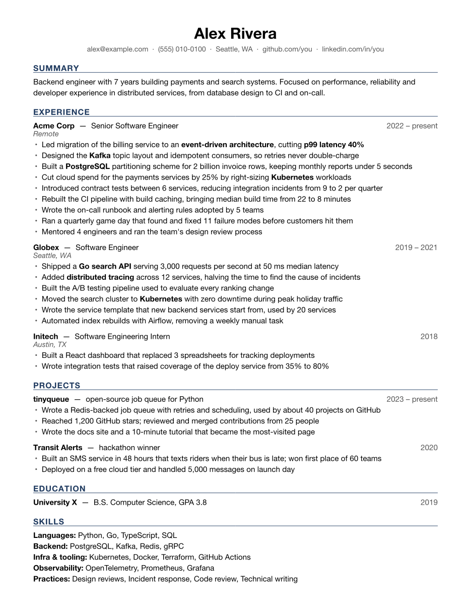

# job-harness

A human-in-the-loop job application harness, built to be driven by a coding agent (Claude Code, Codex, ...).
Keep one big "main" resume; the agent finds jobs, tailors a PDF per posting, and fills the application form.
**You approve every step and press Submit yourself.**

## Setup

### 1. Get the repo and the tools
```bash
git clone https://github.com/tfukaza/job-harness && cd job-harness
```
You need:
- a coding agent (Claude Code, Codex, ...)
- [uv](https://docs.astral.sh/uv/) and Python 3.10+
- [Typst](https://typst.app), which builds the resume PDFs: `brew install typst`
- Chromium, only for automated form filling: `uv run playwright install chromium`

You don't have to install these by hand: the agent checks for them in step 2 and asks before installing anything.

### 2. Run the setup
Open the folder in your coding agent and say: **"set up the harness"**. The agent then:
1. Installs the Python dependencies (`uv sync`) and checks that the tools above are installed.
2. Copies the example files to your private copies: `main/main.yaml`, `main/profile.yaml`,
   `search/criteria.yaml` and `search/companies.yaml`.
3. **Builds your main resume.** Give it your existing resume(s) and it writes everything into `main/main.yaml`,
   every bullet included. Each tailored resume later picks bullets from this file, and nothing gets invented.
   Check what it wrote; `uv run hj check` lists anything still missing.
4. **Fills your profile** by running the `setup-profile` skill. This is a short interview covering the questions
   application forms keep asking: contact details, work authorization, relocation, salary, and optional
   demographics (you can skip those). The answers go to `main/profile.yaml`.
5. **Sets your job search** in `search/criteria.yaml`: job titles, locations, years of experience, and the range
   of required years you're willing to apply for.

### 3. Optional
| What | File | How |
|---|---|---|
| Companies to watch | `search/companies.yaml` | Add companies by their Greenhouse, Lever or Ashby job-board name |
| Resume look | `main/resume-style.yaml` | Copy `main/resume-style.example.yaml`. Styles: `traditional` (default, Times New Roman), `rails`, `classic` |
| Reading job email | `main/mail.yaml` | Copy `main/mail.example.yaml` and set the `HJ_MAIL_PASSWORD` environment variable to an app password. Read-only |
| How much the agent does alone | `main/mode.yaml` | Copy `main/mode.example.yaml`. `review` is the default (you approve everything) |
| Answers in your own writing style | `main/voice.yaml` | Copy `main/voice.example.yaml`, then run `uv run hj voice collect` |

Everything in `main/`, `jobs/`, `tracker/` and your search files is gitignored and stays on your machine.

## Resume styles
Every tailored resume is one full page, auto-fitted by `hj build`. Three looks ship with the harness; pick one with
`base:` in `main/resume-style.yaml` (or try one with `uv run hj build --style rails jobs/<slug>`).

| `traditional` (default) | `rails` | `classic` |
|---|---|---|
| [](docs/samples/traditional.pdf) | [](docs/samples/rails.pdf) | [](docs/samples/classic.pdf) |
| Times New Roman, all black | Geist + Geist Mono, side rails | Helvetica, navy headings |

The sample is fictional: `jobs/example/draft.yaml`, built from `main/main.example.yaml`. Click a picture for its PDF.

## Use
Say **"find me jobs"**. Like or dislike each job the agent shows, and say why. The next round uses your answers.
Pick a job and the agent researches the company, then drafts a tailored resume. You review the draft and set
`approved: true`, and the agent fills the application form. You press Submit.

Everything the agent needs (rules, workflow, commands) is in [AGENTS.md](AGENTS.md).

## Credits
`resume-style` paraphrases the [Harvard College Guide to Creating a Strong Resume](https://careerservices.fas.harvard.edu/resources/create-a-strong-resume/)
(Harvard FAS Mignone Center for Career Success; not endorsed by Harvard). YC discovery uses the
[yc-oss](https://github.com/yc-oss/api) dataset.
